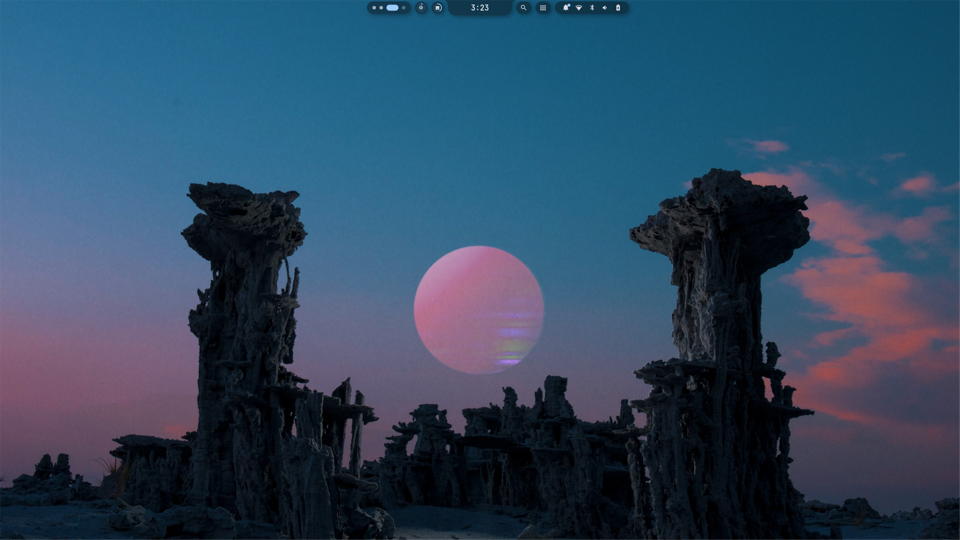
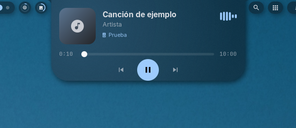
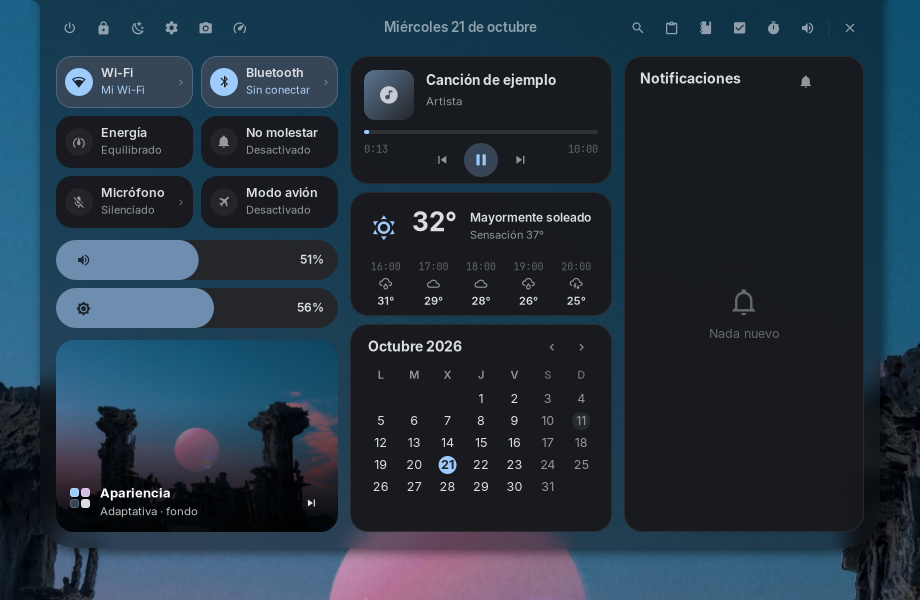
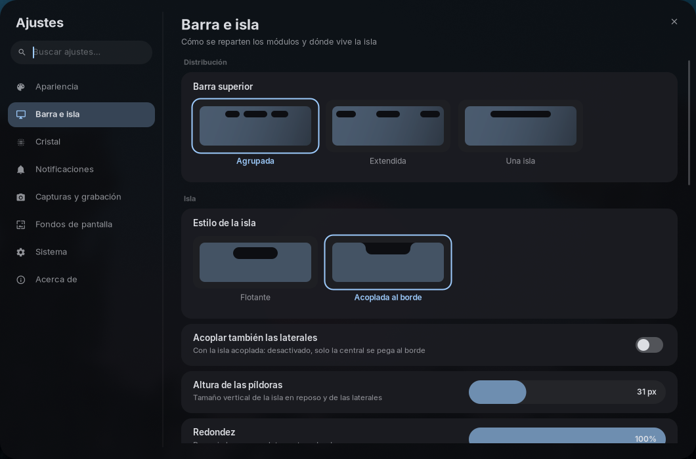
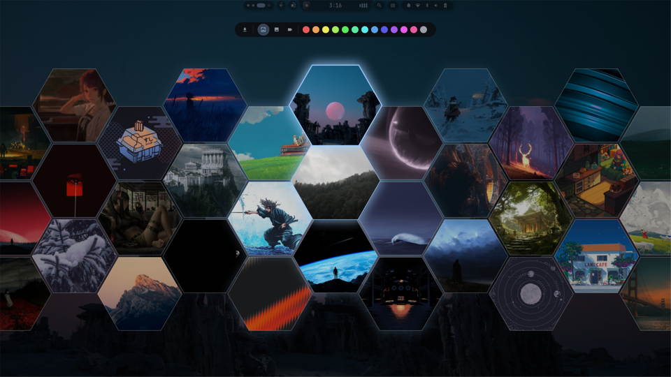
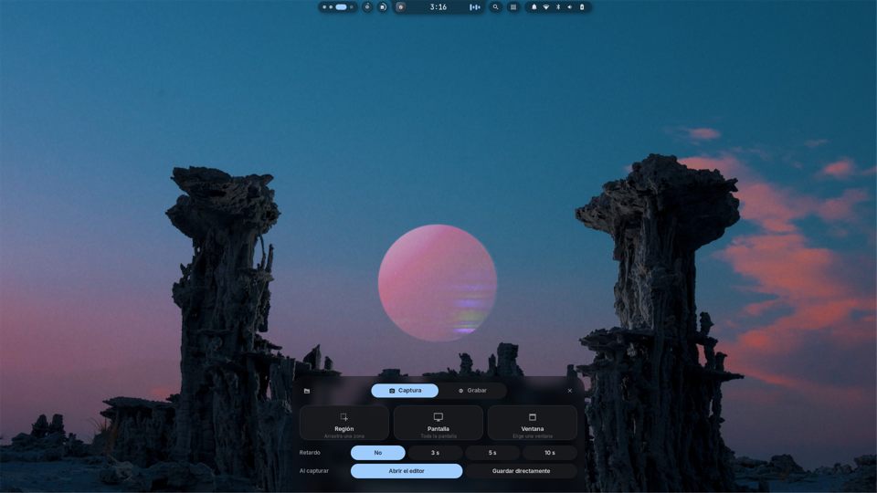
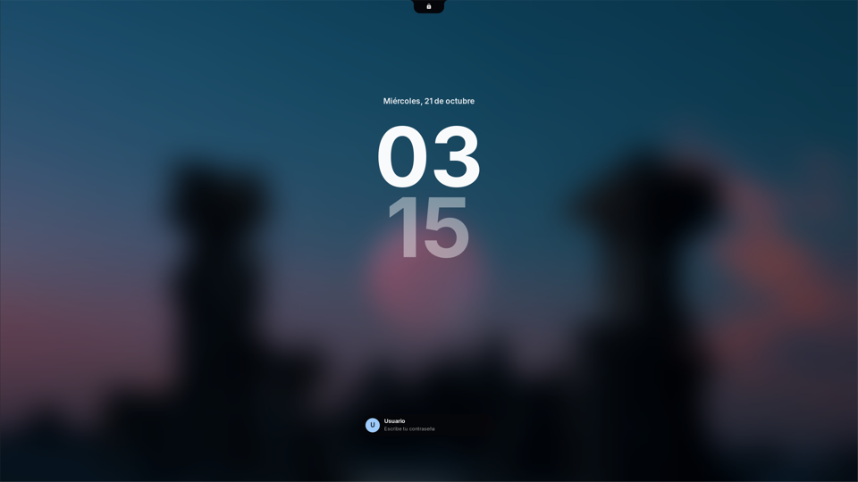

# niri-island 🏝️

Un shell completo para el compositor Wayland **niri**, nativo en **C++20** (Cairo + Pango + layer-shell), alrededor
de una **isla dinámica**: una cápsula que cambia de forma y se convierte en reloj, reproductor, notificaciones, OSD,
centro de control, lanzador, calendario, tareas, notas y más. Inspirado en
[impasto](https://github.com/andreumassanet/impasto) (diseño y animaciones) y en
[noctalia](https://github.com/noctalia-dev/noctalia) (backend nativo basado en `poll`). **Sin Qt, sin QML, sin JS.**

Sustituye por sí solo a la barra, el demonio de notificaciones, el gestor de fondos, la bandeja del sistema y la
pantalla de bloqueo.



| | |
|---|---|
|  |  |
| **Al pasar el ratón**: el reproductor sale de la isla | **Centro de control** |
|  |  |
| **Ajustes**, con buscador | **Selector de fondos** (estilo panal; también carrusel y tarjetas) |
|  |  |
| **Captura** (Mod+S): la pantalla se congela y sale la burbuja | **Pantalla de bloqueo** propia |

---

## Arquitectura

```
src/
├── core/       bucle de eventos, procesos seguros, IPC, Wayland (layer-shell, session-lock, blur), config, inotify
├── services/   MPRIS, notificaciones, audio (PulseAudio), energía, red, Bluetooth, niri, clima, temporizador,
│               SQLite, lanzador/calculadora, cava, imágenes/iconos, bandeja del sistema (StatusNotifierItem)
├── ui/         tema (paleta adaptativa), pintor (Cairo/Pango), regiones de clic, widgets
├── views/      cada capa y panel de la isla, módulos de la barra, ajustes
├── suite/      overlays a pantalla completa: fondos (backdrop + selector), capturas, protector, bloqueo
└── island/     la app: arbitraje de capas, morph, entrada, comandos IPC, barras de las esquinas
tests/          tests unitarios (ctest), prueba de humo y un reproductor MPRIS falso para pruebas
```

- **Un solo hilo de estado.** Todo pasa por un bucle `poll` (Wayland, D-Bus de sesión y sistema, udev, inotify,
  niri, IPC, temporizadores). Lo lento (nmcli, descargas, decodificar y escalar imágenes, PAM) va a workers y vuelve
  al hilo principal.
- **Procesos sin shell** (`fork/exec` con argumentos separados) y timeouts para los hijos colgados.
- **Regiones de clic registradas al dibujar**: el hit-testing usa exactamente lo que se ve.
- **Rendimiento**: cachés de sombras, sprites, miniaturas recortadas y brillos; los overlays se funden desde una
  instantánea; las barras de las esquinas solo se redibujan cuando cambia lo que muestran; el espectro de audio va
  en su propia subsuperficie, así que con música la isla en reposo no se redibuja (~2 % de un núcleo). La isla va a
  1–3 ms por frame y los overlays a 5–13 ms.
- **Varias pantallas**: el fondo y el protector cubren cada una; la captura y los paneles usan la enfocada.

## La isla y la barra

- **Reposo**: reloj centrado y, a los lados, lo que está en marcha (carátula y espectro de audio, temporizador o
  cronómetro, micrófono en uso, grabación).
- **Resumen** al posar el puntero: hora, fecha, clima, batería, CPU/RAM, próxima tarea, o el **reproductor** con el
  color de la carátula. Si hay un temporizador activo aparece en una franja con sus controles.
- **Módulos de la barra** (Ajustes → Barra e isla): espacios de trabajo, ventana activa, buscador, bandeja del
  sistema, notificaciones, red, Bluetooth (solo si está activo), volumen, batería (con o sin porcentaje; rayo al
  cargar) y un **monitor de rendimiento** en su propia isla (CPU, RAM, temperatura, red, disco y swap a elegir; en
  números o en anillos; clic abre el panel del sistema). Cada uno se activa o desactiva, se coloca a la izquierda o a la derecha y se ordena.
- **Distribuciones**: agrupada (cápsulas junto a la isla), extendida (en las esquinas; los paneles caen bajo su
  botón) o una sola isla. La isla puede flotar o acoplarse al borde (con o sin las laterales).
- **Aspecto**: altura de las píldoras, redondez, sombras (control circular de dirección, distancia, suavidad y
  opacidad), cristal translúcido y desenfoque de niri con o sin xray, separación con las ventanas.
- **Paleta adaptativa**: los colores salen del fondo de pantalla (matugen) y cambian con un fundido.

## Paneles

Centro de control, Wi-Fi (QR para compartir), Bluetooth, sonido tipo pavucontrol (salidas, entradas y apps, mover una
app a otra salida), clima, calendario y tareas, tablero kanban, notas manuscritas, sistema, sesión (navegable con ← →),
temporizador y cronómetro con vueltas, **notificaciones** (historial y No molestar: avisos, discreto o total),
**bandeja del sistema** (iconos de las apps en la barra; clic abre, clic derecho muestra su menú), **portapapeles**
(lista y vista completa, imágenes incluidas; doble clic pega en la ventana que tenía el foco) y **ajustes** con buscador.

**Lanzador** (`niri-island launcher`): aplicaciones; `=` calculadora, `@` ventanas, `!` temporizador, `>` acciones,
`'` portapapeles, `?` buscar en la web.

## Suite

- **Fondos de pantalla propios**: la isla pinta el fondo (imágenes; vídeos con `mpvpaper`), lo recuerda y genera la
  paleta. Selector con tres estilos (Ajustes → Fondos): **carrusel** de slices retroiluminados que sale de la isla,
  **panal** de hexágonos como el de skwd-wall y **tarjetas** como la web de wallhaven; filtros por tipo y color, y
  aplicación instantánea. Modo **wallhaven**: cuadrícula desplazable, búsqueda, orden, color, contenido
  +18 opcional (marcado en rojo) y descarga a `~/Imágenes/wallpapers/wallhaven`. Los fondos de vídeo **se pausan**
  mientras una ventana ocupa la pantalla (completa o maximizada), como en skwd-wall; se desactiva en Ajustes → Fondos.
- **Capturas** (Mod+S): la pantalla se congela al instante tal cual está, islas y paneles incluidos, y una burbuja
  que sale del borde inferior pregunta qué hacer; editor con región, formas, flechas, texto, pixelado, contador y
  deshacer. Mientras dura, el teclado es solo de la captura. **Grabación** con pausa,
  audio del sistema y/o micrófono, VA-API y MP4/MKV/GIF.
- **Protector de pantalla** "Burbujas" (a lo Windows Vista): salen en fila soplando, se dispersan y rebotan. La
  isla lo lanza sola tras unos minutos sin usar el equipo (respeta vídeos y llamadas que lo impiden); en Ajustes →
  Sistema: espera, bloquear también tras un tiempo, cantidad y velocidad de las burbujas, y probarlo.
- **Pantalla de bloqueo** propia sobre `ext-session-lock`: fondo difuminado, fecha, reloj grande, avatar
  (`~/.face`) y contraseña comprobada con PAM. Si la isla se cerrara, la sesión sigue bloqueada.

## Compilar

```bash
sudo apt install build-essential cmake ninja-build libwayland-dev wayland-protocols \
    libcairo2-dev libpango1.0-dev libgdk-pixbuf-2.0-dev libsystemd-dev libpulse-dev libudev-dev \
    libxkbcommon-dev libsqlite3-dev libcurl4-openssl-dev libqrencode-dev nlohmann-json3-dev libpam0g-dev
cmake -B build -G Ninja -DCMAKE_BUILD_TYPE=Release
cmake --build build
sudo cp /etc/pam.d/swaylock /etc/pam.d/niri-island   # servicio PAM del bloqueo (o uno con "auth include login")
```

Opcionales en tiempo de ejecución: `nmcli`, `cava`, `cliphist` + `wl-clipboard` + `wtype` (portapapeles),
`matugen` (paleta), `mpvpaper` (fondos de vídeo), `wf-recorder` + `ffmpeg` (grabación), `grim`, `swayidle`
(protector e inactividad), `brightnessctl`, `power-profiles-daemon`.

## Integración con niri

`startup.kdl`:

```kdl
spawn-at-startup "niri-island"
spawn-at-startup "swayidle" "-w" "before-sleep" "niri-island lock"   # bloquear antes de suspender
```

La isla escribe sus propias reglas en `~/.config/niri/cfg/niri-island.kdl` (fondo detrás de la vista general,
desenfoque); inclúyelo desde `config.kdl` con `include "cfg/niri-island.kdl"`.

Atajos sugeridos (`binds.kdl`):

```kdl
Mod+D       { spawn-sh "niri-island launcher"; }
Mod+Z       { spawn-sh "niri-island cc"; }
Mod+V       { spawn-sh "niri-island clipboard"; }
Mod+P       { spawn-sh "niri-island settings"; }
Mod+W       { spawn-sh "niri-island wallpapers"; }
Mod+L       { spawn-sh "niri-island lock"; }
Mod+Shift+E { spawn-sh "niri-island session"; }
Mod+S       { spawn-sh "niri-island capture"; }          # congela la pantalla y abre la burbuja
Print       { spawn-sh "niri-island screenshot region"; }
Mod+Print   { spawn-sh "niri-island capture record"; }
XF86MonBrightnessUp   { spawn-sh "niri-island brightness-up"; }
XF86MonBrightnessDown { spawn-sh "niri-island brightness-down"; }
```

Todos los paneles se cierran con el mismo atajo que los abre.

## Comandos

`niri-island help` lista todo. Los principales:

```
paneles   cc launcher [texto] wifi bt sound weather calendar tasks notes note-new stats session clipboard
          notifications tray timer stopwatch settings [sección] glance close back
suite     wallpapers [wallhaven] | wallpaper [current|next|prev|set <ruta>] | capture [record] |
          screenshot [region|screen|window] | record [...] | screensaver [stop] | lock [--preview <s>] | lock-state
media     play-pause next prev
niveles   volume-up volume-down volume <n> mute mic-mute brightness-up brightness-down
toggles   toggle-wifi toggle-bluetooth dnd [off|discreet|total|cycle] toggle-airplane power-profile [nombre]
otros     notify <app> <resumen> <cuerpo> notifications-clear battery tray-list reload status
```

## Configuración

`~/.config/niri-island/config.json` se crea la primera vez y se recarga solo al guardarlo; casi todo se edita desde
**Ajustes** (`Mod+P`). Datos en `~/.local/state/niri-island/` (tareas y notas en SQLite, notificaciones, fondo actual)
y cachés en `~/.cache/niri-island/`.

Depuración: `NIRI_ISLAND_DEBUG=1` imprime fps y ms por frame de la isla; `NIRI_ISLAND_OVLOG=1` los de los overlays.

## Tests

```bash
cmake --build build && ctest --test-dir build --output-on-failure   # tests unitarios
tests/smoke.sh                         # con la isla en marcha: abre y cierra todo, comprueba que sigue viva
python3 tests/fake_mpris.py &          # un reproductor falso "reproduciendo", para probar la música
```

Los unitarios cubren utilidades, la calculadora, los nombres de la bandeja, la configuración (valores por
defecto, módulos nuevos, guardado, JSON roto) y el cierre con una descarga en curso. La prueba de humo no guarda
ni cambia nada. Para buscar errores de memoria, una compilación con sanitizers:

```bash
cmake -B build-asan -DCMAKE_BUILD_TYPE=Debug -DCMAKE_CXX_FLAGS="-fsanitize=address,undefined -fno-omit-frame-pointer"
cmake --build build-asan && build-asan/niri-island-tests
```

Para capturas de pantalla, `niri-island debug-demo on` deja fuera lo personal (lugar del clima, nombres de
Wi-Fi, notificaciones, tareas, el nombre en el bloqueo) hasta `debug-demo off`.

Las comprobaciones con la isla en marcha se hacen con sus comandos de depuración por IPC (`debug-click`,
`debug-move`, `debug-settings-click`, `debug-settings-scroll`, `debug-settings-search`, `debug-capbar-click`…),
no con pulsaciones simuladas, que irían a la ventana que tenga el foco.

## Licencia

GPL-3.0-or-later. Puedes usarlo, modificarlo y redistribuirlo; si distribuyes una versión modificada, debe
seguir siendo libre bajo la misma licencia y con su código fuente. El texto completo está en [`LICENSE`](LICENSE).
